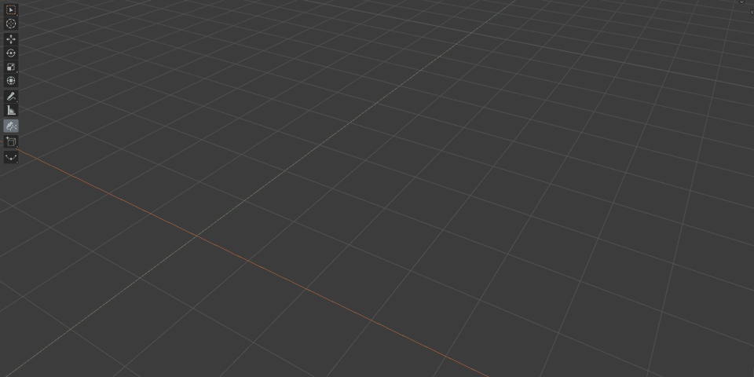

# Shape Draw

[](https://github.com/DevTomUK/shape-draw/actions/workflows/ci.yml)

Draw the outline of a shape in Blender's 3D View, with sharp corners and smooth curves, then pull it up into a solid mesh in one go.



## Install

Blender 4.2 or newer.

- **From Blender**: Edit > Preferences > Get Extensions, search for "Shape Draw". *(once it's published)*
- **From a zip**: download `shape_draw-<version>.zip` from [Releases](https://github.com/DevTomUK/shape-draw/releases), then Edit > Preferences > Get Extensions > ⌄ menu > Install from Disk.

## Use

Pick **Draw Shape** in the toolbar (or Add > Draw Shape).

| While drawing | |
| --- | --- |
| Click | sharp corner |
| Click and drag | smooth curved point |
| Click the first point, or Enter | close the outline |
| Type a number | exact length for the next edge (Enter places it, Esc stops typing) |
| Shift | lock the edge to 15° steps |
| Ctrl | turn grid snapping off (edges still lock onto the X / Y axis) |
| Backspace / Ctrl+Z | remove the last point |
| P / R / C | outline / rectangle / circle |
| Right-click / Esc | cancel |

| Rectangle and circle | |
| --- | --- |
| Rectangle: click or drag | corner to corner (Shift for a square) |
| Circle: click, then click or drag | centre, then radius |
| Circle: type a number | exact radius |

| While extruding | |
| --- | --- |
| Move the mouse | height (snaps to the grid step) |
| Type a number | exact height (- flips it) |
| Click / Enter | finish |
| Right-click | back to drawing |

### Edit an outline later

Select a shape and press **E** with the tool active (or use **Edit Outline** in the tool header, the Object menu or the right-click menu). The outline comes back on the object, wherever it is now:

| Edit Outline | |
| --- | --- |
| Drag a point or handle | move it (Alt on a handle breaks the curve) |
| Click an edge | add a point there |
| V / double-click a point | corner or curve |
| X / Delete over a point | remove it |
| H | change the height |
| Enter / Esc | keep / undo the changes |

The object is rebuilt in place and keeps its position, parent, modifiers and materials. Select an object with a cut in it to edit its newest cut. Shapes made before 0.2.0 don't have a stored outline.

Click a face of another object to start the shape on that face. Then use **Attach** in the redo panel to parent the shape to that object, join it in, or cut it in with a live boolean.

Tool settings (header or N panel): shape (outline, rectangle, circle), grid step and snapping, Lock to Axis, Draw on Surfaces.

## Develop

Everything lives in this folder:

```
shape_draw.py           the add-on (one file)
__init__.py             extension entry point (imports shape_draw)
blender_manifest.toml   extension manifest: id, version, tags, build excludes
LICENSE                 GPL-3.0-or-later
CHANGELOG.md            release notes, one "## <version>" section per release
make.py                 test / check / build / install
tests/                  smoke_test.py (plain Python), headless_test.py (Blender --background)
listing/                store copy, icon, featured image, screenshots, demo.gif (not shipped in the zip)
dist/                   built zips (git-ignored)
PUBLISHING.md           where it's published and the release steps
.github/workflows/      CI: ruff + tests on Blender 4.2 and 5.2; tags v* make a GitHub release
```

```
python make.py test      # both test suites
python make.py build     # version check, validate, test, build dist/shape_draw-<version>.zip
python make.py install   # build, then install into your Blender
```

Blender is found automatically; set `BLENDER` to its path if it isn't.

## License

GPL-3.0-or-later. See [LICENSE](LICENSE).
